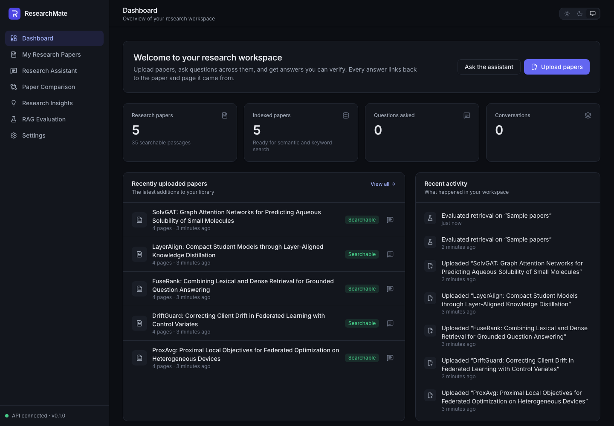
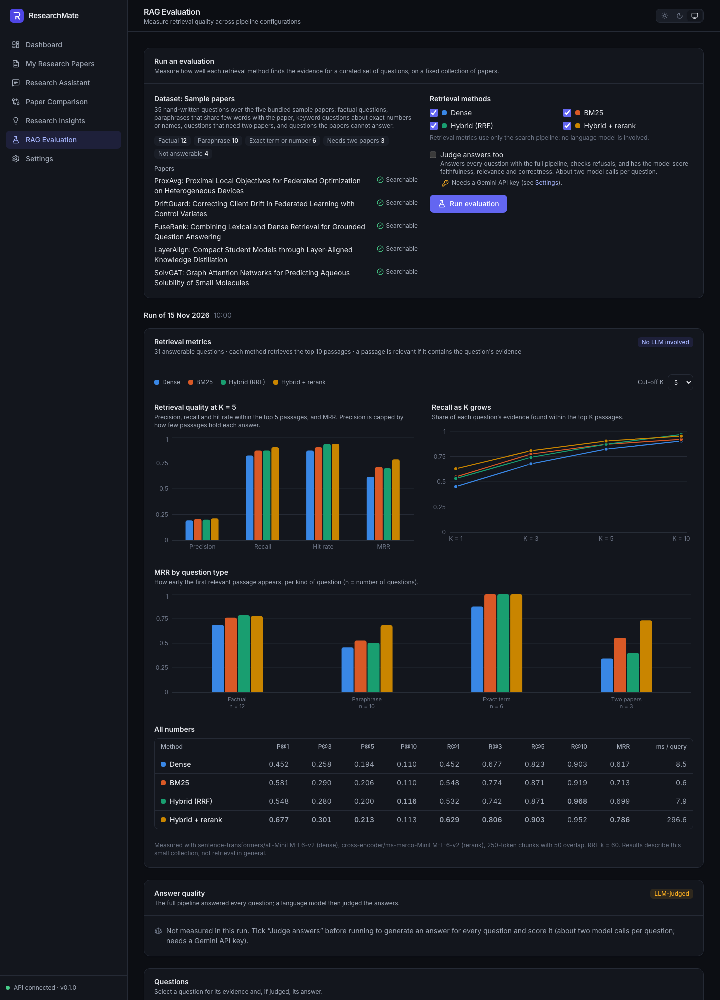
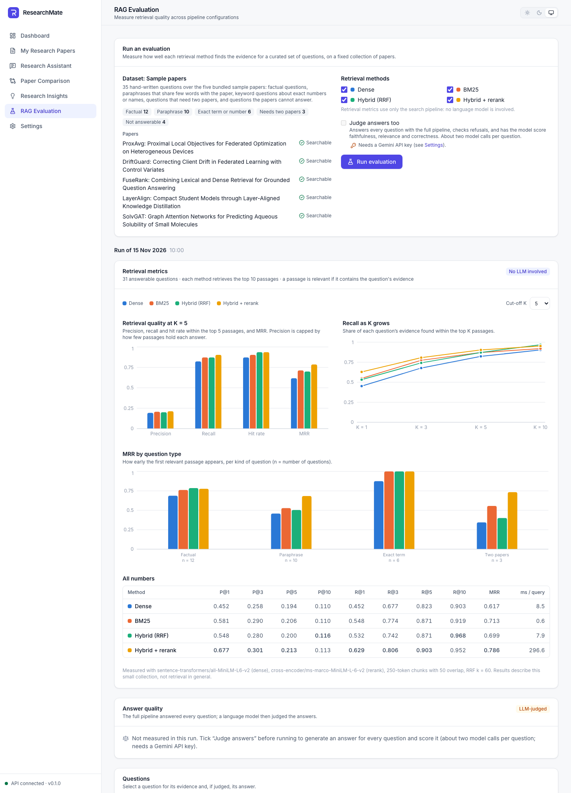
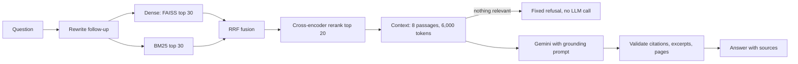

# ResearchMate

**Ask questions across your research papers and get answers you can check.** Upload PDFs,
then ask, summarise, compare and look for research gaps. Every statement cites the paper,
the page and the sentence it relies on, and when your papers don't support an answer,
ResearchMate says so instead of guessing.

It is a full retrieval-augmented generation (RAG) system built from the components up:
PDF extraction, sentence-aware chunking, dense embeddings in FAISS, BM25, rank fusion,
cross-encoder reranking, a grounded LLM prompt, citations validated in code, and an
evaluation dashboard that measures each retrieval method on a curated dataset.

---

## Contents

- [Problem statement](#problem-statement)
- [Features](#features)
- [Screenshots](#screenshots)
- [Architecture](#architecture)
- [Technology stack](#technology-stack)
- [RAG workflow](#rag-workflow)
- [Getting started](#getting-started)
- [Environment setup](#environment-setup)
- [API documentation](#api-documentation)
- [Evaluation methodology](#evaluation-methodology)
- [Technical reasoning](#technical-reasoning)
- [Example questions](#example-questions)
- [Testing](#testing)
- [Project structure](#project-structure)
- [Limitations and future improvements](#limitations-and-future-improvements)
- [How to explain this project in an interview](#how-to-explain-this-project-in-an-interview)

---

## Problem statement

Reading a stack of papers to answer "which datasets did these use?" or "what do they
assume?" is slow, and general-purpose chatbots are risky help: they answer from memory,
invent citations, and can't say which page a claim came from. Researchers need answers
that are:

- **grounded** in the papers they actually uploaded, not the model's training data;
- **traceable** to a paper, a page and a sentence, so every claim can be verified;
- **honest** about gaps: "the papers don't cover this" is a valid answer;
- **measurable**: if retrieval misses the right passage, the answer is wrong no matter
  how good the language model is, so retrieval quality has to be evaluated, not assumed.

ResearchMate is built around those four requirements.

## Features

**Paper library**
- Upload several PDFs at once with progress bars; type, size and page-count limits.
- Duplicate detection by SHA-256 of the file; titles detected from metadata, the largest
  first-page heading, or the file name.
- Text extracted page by page (page numbers preserved); scanned PDFs without a text layer
  are detected and explained instead of silently indexed (OCR is not supported).
- Delete papers (their passages, vectors, summary and analyses go with them) and re-index
  them; unchanged papers are not re-embedded.

**Research Assistant**
- Chat grounded in your papers, limited to one paper, a selection, or all of them.
- Follow-up questions are rewritten into standalone questions before searching.
- Answers cite sources as `[S1]`, `[S2]`; citations are checked in code: citations to
  passages the model wasn't given are removed, every cited source shows its supporting
  sentence and exact page, and claims without a citation are flagged.
- When nothing relevant is retrieved, the fixed refusal is returned without calling the
  model: *"I couldn't find sufficient supporting information in the uploaded research
  papers to answer this question."*

**Summaries, comparisons and research gaps**
- **Summary:** nine sections per paper (objective, problem, method, algorithms, datasets,
  setup, results, limitations, future work), each cited, or "not found".
- **Comparison:** two to five papers side by side on ten aspects; every cell cites its own
  paper, and missing values say "Not reported". Ask follow-up questions in which every
  compared paper gets a share of the evidence.
- **Research Insights:** limitations the papers *state*, patterns *observed* across them
  (recurring challenges, differences, topics few address) and *inferred* research
  directions, each checked in code (a "pattern" must cite at least two papers) and scoped
  to the selected papers, never claimed as gaps in the literature.

**Evaluation and transparency**
- **RAG Evaluation:** a bundled sample collection and 35 curated questions; Precision@K,
  Recall@K, hit rate and MRR for dense, BM25, hybrid and hybrid + rerank, per question
  type; optional LLM-judged answer quality, shown separately; run history.
- **Retrieval playground:** run any query through all four retrieval stages side by side
  and see exactly which passages would be sent to the model, and why others were dropped.

**Product**
- Dashboard with totals, recent papers and activity, light and dark themes, responsive
  down to phone width, keyboard accessible.

## Screenshots

All screenshots show the app running on the bundled synthetic sample papers.

| | |
|---|---|
|  |  |
| **Dashboard**: totals, recent papers and activity, quick actions | **Paper library**: status, metadata and actions per paper |
|  |  |
| **RAG Evaluation**: retrieval metrics per method, measured | **Light theme** |

Screens that show generated text (answers, summaries, comparisons, insights) are not
included yet: they were developed and tested against a scripted stand-in model, and
screenshots of those would not show real Gemini output.

## Architecture

```
┌──────────────────────────── React + TypeScript (Vite) ────────────────────────────┐
│  Dashboard · Papers · Assistant · Comparison · Insights · Evaluation · Settings  │
│                       services/api.ts  (typed REST client)                        │
└───────────────────────────────────────┬───────────────────────────────────────────┘
                                        │  JSON over HTTP (/api/*)
┌───────────────────────────────────────▼───────────────────────────────────────────┐
│ FastAPI   routers/  →  thin HTTP layer: validation, status codes, error mapping   │
│           schemas/  →  Pydantic request/response contracts                        │
├───────────────────────────────────────────────────────────────────────────────────┤
│ services/ (business logic, no HTTP knowledge)                                     │
│                                                                                   │
│  Ingestion:  file_validation → pdf_service → text_cleaning → chunking_service     │
│              → embedding_service → vector_store (FAISS) + SQLite metadata         │
│                                                                                   │
│  Retrieval:  query processing → dense (FAISS) ┐                                   │
│                                BM25 ──────────┴→ RRF fusion → cross-encoder       │
│              rerank → context selection (dedupe + token budget + evidence gate)   │
│                                                                                   │
│  Generation: prompts/ → llm_service (provider interface; Gemini first)            │
│              → citation_service (validate [S#] markers against given sources)     │
│                                                                                   │
│  Analysis:   paper profiles (summary + comparison views) · research_gap           │
│  Evaluation: dataset → per-method retrieval runs → P@K / R@K / MRR                │
│              + optional LLM-judged faithfulness / relevance (kept separate)       │
├───────────────────────────────────────────────────────────────────────────────────┤
│ Persistence: SQLite via SQLAlchemy (documents, pages, chunks, conversations,      │
│              profiles, analyses, evaluation runs, activity) · FAISS index on disk │
│              · uploaded PDFs on disk                                              │
└───────────────────────────────────────────────────────────────────────────────────┘
```

- Routers only translate HTTP; all logic lives in services, which receive their
  dependencies (settings, database, models) explicitly, so tests can swap in fakes.
- The FAISS vector id **is** the chunk's SQLite primary key, so the two stores can't
  drift apart; a startup check repairs anything left half-done by a crash.
- The LLM sits behind a small provider interface; Gemini is one class, and adding
  another provider doesn't touch the pipeline.

The detailed design record, with every decision and the measurements behind it, is in
[docs/ROADMAP.md](docs/ROADMAP.md).

## Technology stack

| Layer | Choice | Why |
|---|---|---|
| API | FastAPI, Pydantic v2, Uvicorn | Typed request/response contracts and automatic OpenAPI docs |
| Storage | SQLAlchemy 2, SQLite (WAL) | Zero setup locally; portable column types so PostgreSQL is a configuration change |
| PDF | PyMuPDF | Fast, accurate page-level text and font information (used for title detection) |
| Embeddings | Sentence Transformers `all-MiniLM-L6-v2` | Small (≈90 MB), fast on a laptop CPU, good general-purpose quality |
| Vector search | FAISS (CPU), `IndexIDMap2(IndexFlatIP)` | Exact cosine search, persisted to disk, ids map 1:1 to chunks |
| Keyword search | rank-bm25 (Lucene IDF) | Exact terms, names and numbers that embeddings blur |
| Fusion | Reciprocal Rank Fusion, k = 60 | Combines rankings without calibrating incompatible scores |
| Reranking | Cross-encoder `ms-marco-MiniLM-L-6-v2` | Reads question and passage together; better ordering of the top candidates |
| LLM | Google Gemini (`gemini-3.6-flash`) via `google-genai` | Free tier, JSON-schema output, swappable behind `LLMProvider` |
| Frontend | React 19, TypeScript, Vite, Tailwind CSS v4 | Fast builds, typed API client, a small design system |
| UI | Lucide icons, Recharts | Consistent icons; charts for the evaluation dashboard |
| Tests | pytest, httpx (`TestClient`), Vitest | API-level tests with deterministic fakes for every model |
| Delivery | Docker, Docker Compose, nginx | One command to run; nginx serves the app and proxies `/api` |

## RAG workflow

**Ingestion** (on upload; indexing runs in the background):

1. **Validate and store**: extension and PDF signature, size limit, SHA-256 duplicate check.
2. **Extract** text page by page with PyMuPDF; detect the title; flag pages with no text.
3. **Clean**: fix hyphenation and ligatures, drop repeated headers and footers and page
   numbers.
4. **Chunk**: sentence-aware chunks of 250 tokens with 50 tokens of overlap, measured
   with the embedding model's own tokenizer; never split across sections; each chunk keeps
   its page range and section heading.
5. **Embed** chunks in batches (L2-normalised) and add them to FAISS under their chunk
   ids; BM25 is built in memory from the same chunks and rebuilt when they change.

**Answering a question**:

1. **Rewrite** a follow-up into a standalone question using recent turns (no history is
   sent to the answer step, so earlier answers can't leak in).
2. **Retrieve** the top 30 passages by dense search and the top 30 by BM25, both limited to
   the selected papers *inside* each retriever.
3. **Fuse** the two rankings with Reciprocal Rank Fusion.
4. **Rerank** the top 20 with the cross-encoder.
5. **Select context**: up to 8 passages within 6,000 tokens, dropping near-duplicates;
   when several papers are selected, each gets guaranteed slots.
6. **Refuse without the model** if nothing usable is left.
7. **Generate** with a strict grounding prompt: sources are numbered `[S1]…[Sn]`, labelled
   untrusted, and the model must cite or use the exact refusal sentence.
8. **Validate citations** in code: drop invented ids, find each cited passage's supporting
   sentence and exact page, flag uncited claims, and save the answer with its sources.



## Getting started

### Option 1: Docker (recommended)

Requirements: Docker with Compose v2.24 or later.

```bash
git clone https://github.com/mahajanp2804/ResearchMate.git
cd ResearchMate
cp backend/.env.example backend/.env   # optional: add GEMINI_API_KEY for answers
docker compose up --build
```

Open **http://localhost:8080**. API docs are at http://localhost:8080/docs.

- Papers, the database and the FAISS index live in the `researchmate-data` volume; the
  embedding and reranking models are downloaded once, on first use, into `model-cache`.
- The images install the CPU-only build of PyTorch, so no GPU or CUDA is needed.
- Without `backend/.env` the app still starts; uploads, search, the playground and
  retrieval evaluation work, and generated features explain that a key is needed.

### Option 2: Local development

Requirements: Python 3.12, Node.js 20.19+ or 22.12+.

**Backend** (http://localhost:8000, API docs at http://localhost:8000/docs):

```bash
cd backend
python3.12 -m venv .venv
.venv/bin/pip install -r requirements-dev.txt
cp .env.example .env          # then add GEMINI_API_KEY
.venv/bin/uvicorn app.main:app --reload --port 8000
```

**Frontend** (http://localhost:5173; Vite proxies `/api` to the backend):

```bash
cd frontend
npm install
npm run dev
```

The first upload downloads the embedding model (≈90 MB) and the first reranked search the
cross-encoder (≈90 MB); both are cached afterwards.

### Try it with the sample papers

Open **RAG Evaluation** and select **Add the sample papers**: five short synthetic papers
are generated and indexed. Then run an evaluation, try the retrieval playground, or ask
the assistant about them. (The sample papers' methods, authors and results are fictional;
they exist so that evaluation is reproducible without shipping copyrighted PDFs.) For a
real demonstration, upload papers from arXiv; any text-based PDF works.

## Environment setup

All settings are environment variables (or `backend/.env`); see
[backend/.env.example](backend/.env.example) for the full list with comments.

| Variable | Default | Purpose |
|---|---|---|
| `GEMINI_API_KEY` | (none) | Enables answers, summaries, comparisons, gap analyses and answer judging. Free key: https://aistudio.google.com/apikey |
| `GEMINI_MODEL` | `gemini-3.6-flash` | Gemini model |
| `EMBEDDING_MODEL_NAME` | `sentence-transformers/all-MiniLM-L6-v2` | Embedding model (changing it re-embeds papers on re-index) |
| `EMBEDDING_DEVICE` | `cpu` | `mps` uses the Apple Silicon GPU |
| `CHUNK_SIZE_TOKENS` / `CHUNK_OVERLAP_TOKENS` | `250` / `50` | Chunking; sized to the embedding model's 256-token window |
| `DENSE_TOP_K` / `BM25_TOP_K` / `RRF_K` | `30` / `30` / `60` | First-stage retrieval and fusion |
| `RERANKER_ENABLED` / `RERANK_CANDIDATES` | `true` / `20` | Cross-encoder reranking |
| `FINAL_CONTEXT_CHUNKS` / `MAX_CONTEXT_TOKENS` | `8` / `6000` | Context sent to the model |
| `MIN_PASSAGES_PER_PAPER` | `2` | Guaranteed context slots per selected paper |
| `MAX_UPLOAD_SIZE_MB` / `MAX_FILES_PER_UPLOAD` | `50` / `10` | Upload limits |
| `DATA_DIR` | `data` | Uploads, SQLite database and FAISS index |

The frontend reads `VITE_API_PROXY_TARGET` (development proxy) and `VITE_API_BASE_URL`
(only when the API is on another origin); see [frontend/.env.example](frontend/.env.example).

## API documentation

Interactive documentation (OpenAPI) is served at `/docs`. Errors share one shape:
`{"error": {"code": "...", "message": "...", "details": {...}}}`.

| Method | Path | Purpose |
|---|---|---|
| GET | `/api/health` | Health, database status, whether an LLM is configured |
| GET | `/api/system/info` | Non-secret configuration (models, limits, retrieval settings) |
| GET | `/api/dashboard/stats` | Totals, recent papers and recent activity |
| POST | `/api/documents/upload` | Upload PDFs; each file is `created`, `duplicate` or `rejected` |
| GET | `/api/documents` | List papers |
| GET | `/api/documents/{id}` | One paper with its metadata, index details and pages without text |
| DELETE | `/api/documents/{id}` | Delete a paper, its passages, vectors and analyses |
| POST | `/api/documents/{id}/reindex` | Re-chunk and/or re-embed only what changed |
| GET | `/api/documents/{id}/chunks` | The passages a paper was split into |
| GET | `/api/documents/{id}/file` | The original PDF (open at a page with `#page=N`) |
| POST | `/api/retrieval/search` | Compare dense, BM25, hybrid and hybrid + rerank for a query |
| POST | `/api/retrieval/context` | The exact passages the answer step would receive |
| POST | `/api/chat/query` | Ask a question (optionally in a conversation, limited to papers) |
| GET | `/api/chat/conversations` | List conversations |
| GET / DELETE | `/api/chat/conversations/{id}` | A conversation with its messages and sources / delete it |
| POST | `/api/research/summarize/{id}` | Nine-section cited summary (saved; `?refresh=true` regenerates) |
| GET | `/api/research/summaries/{id}` | The saved summary, without generating |
| POST | `/api/research/compare` | Compare 2–5 papers on ten aspects |
| POST | `/api/research/gaps` | Stated limitations, observed patterns and inferred directions |
| GET | `/api/evaluation/datasets` | Evaluation datasets and whether their papers are ready |
| POST | `/api/evaluation/sample-papers` | Add the bundled sample papers |
| POST | `/api/evaluation/run` | Start an evaluation run (background; poll the result) |
| GET | `/api/evaluation/results` | Runs, newest first, with aggregate metrics |
| GET / DELETE | `/api/evaluation/results/{id}` | One run with per-question results / delete it |

Example: ask a question about two specific papers.

```bash
curl -s http://localhost:8000/api/chat/query \
  -H 'Content-Type: application/json' \
  -d '{"question": "Which datasets were used?", "document_ids": ["<id-1>", "<id-2>"]}'
```

## Evaluation methodology

Retrieval is evaluated without any language model, on a fixed collection, so the numbers
are reproducible:

- **Collection**: five short synthetic papers (35 chunks), generated as PDFs from
  [backend/evaluation/sample_papers.json](backend/evaluation/sample_papers.json). Two
  share a topic so retrieval has to tell similar papers apart.
- **Dataset**: 35 hand-written questions in
  [backend/evaluation/datasets/sample_papers.json](backend/evaluation/datasets/sample_papers.json):
  12 factual, 10 paraphrases (different wording from the paper), 6 that hinge on an exact
  term or number, 3 that need two papers, and 4 the papers can't answer. Each answerable
  question lists the exact evidence sentences and a reference answer.
- **Relevance**: a retrieved passage is relevant if it is from the evidence's paper and
  contains the evidence text (compared on letters and digits only). Chunk ids change with
  chunking settings; evidence text doesn't.
- **Metrics** at K = 1, 3, 5, 10: Precision@K, Recall@K (share of the question's evidence
  found), hit rate, and MRR (1 / rank of the first relevant passage), per method and per
  question type.
- **Answer quality** (optional, needs a key): the full pipeline answers every question;
  refusals are checked in code (unanswerable questions should be refused); then the model
  judges faithfulness per statement, context relevance per passage, answer relevance and
  agreement with the reference answer. These scores are labelled *LLM-judged* and shown
  apart from the retrieval metrics.

Run it in the app (RAG Evaluation) or from the command line:

```bash
cd backend && .venv/bin/python -m scripts.run_evaluation            # retrieval only
cd backend && .venv/bin/python -m scripts.run_evaluation --answers  # also judge answers
```

**Measured results** (31 answerable questions; Apple Silicon laptop CPU; 250-token chunks;
latency excludes loading the models):

| Method | P@1 | R@3 | R@10 | MRR | ms / query |
|---|---|---|---|---|---|
| Dense | 0.452 | 0.677 | 0.903 | 0.617 | 7 |
| BM25 | 0.581 | 0.774 | 0.919 | 0.713 | 0.5 |
| Hybrid (RRF) | 0.548 | 0.742 | **0.968** | 0.699 | 7 |
| Hybrid + rerank | **0.677** | **0.806** | 0.952 | **0.786** | 159 |

Reranking ranks best overall and helps most on paraphrased (+0.18 MRR over hybrid) and
two-paper questions, at about 160 ms per query on a CPU. Fusion finds the most evidence
within ten passages. BM25 beats dense even on paraphrases here, which says more about five
short papers with distinctive vocabulary than about dense retrieval in general. The
collection is small (top-10 covers almost a third of it), so R@10 is inflated and
differences of a few hundredths are noise. Answer quality has not yet been measured with
Gemini. Full results and caveats: [docs/ROADMAP.md](docs/ROADMAP.md#phase-11-results-retrieval-measured).

## Technical reasoning

**Why chunking is necessary.** Papers are far longer than an embedding model can read
(`all-MiniLM-L6-v2` reads 256 tokens) and than is useful to put in a prompt. A whole paper
as one vector averages every topic into a blur, and citing "the paper" isn't specific
enough to check. Chunks of 250 tokens fit the model's window exactly (no silent
truncation), are small enough to be about one thing, and carry their own page range, so a
citation can point at a page. Chunks follow sentence boundaries and never cross a section
heading, and consecutive chunks overlap by 50 tokens so an idea split across a boundary
isn't lost.

**Why embeddings are used.** Embeddings map text to vectors whose closeness reflects
meaning, so "phones that can't finish their work in time" can match a passage about
"stragglers" with no words in common. That's what keyword search can't do. Vectors are
L2-normalised so inner product equals cosine similarity.

**Why FAISS was selected.** It is a local, CPU-friendly library rather than a service:
nothing to deploy, persisted to a file, and exact search (`IndexFlatIP`) is fast enough for
tens of thousands of chunks. Wrapping it in `IndexIDMap2` lets the vector id be the chunk's
database id, so search results map straight to text and pages, and deleting a paper
removes exactly its vectors. An approximate index (IVF, HNSW) is a configuration change if
the library ever grows that large.

**Why hybrid retrieval is useful.** Dense and keyword search fail differently. Embeddings
blur exact strings: a dataset name, a hyperparameter value, an identifier. BM25 matches
those exactly but misses paraphrases. Running both and merging with Reciprocal Rank Fusion
(which uses ranks, not their incompatible scores) gets the strengths of each; in the
evaluation, fusion found the most evidence within ten passages (R@10 0.968).

**Why reranking improves retrieval.** First-stage retrievers encode the question and
each passage separately, which is fast but coarse. A cross-encoder reads the question and
a passage *together* and scores how well the passage answers it, which is far more
accurate but too slow to run over everything. So it reorders only the top 20 fused
candidates. Measured here: MRR 0.699 → 0.786, P@1 0.548 → 0.677, at ~160 ms per query on
CPU.

**How citations are generated.** The model never writes page numbers or file names. The
retrieved passages are numbered `[S1]…[Sn]` in the prompt, and the model may only cite
those ids. After generation, code parses every marker (including `[S1, S3]` and
`[S1-S3]`), removes ids that weren't sent, maps each valid id to its stored passage, picks
the passage sentence that best matches the statements citing it as the excerpt, and finds
the exact page of that sentence even when the passage spans two pages. Sentences that make
a claim without any citation are flagged in the UI, and the answer is saved with the full
text of its sources so it stays verifiable later.

**How retrieval evaluation works.** Each curated question names the exact sentences that
answer it. Every retrieval method returns its top 10 passages for the question; a passage
counts as relevant if it is from the right paper and contains an evidence sentence. From
those judgements: Precision@K (share of the top K that is relevant), Recall@K (share of
the evidence found in the top K) and MRR (how early the first relevant passage appears),
averaged over questions and broken down by question type. No model is involved, so the
results are deterministic and comparable across settings.

## Example questions

General questions the assistant is designed for:

- What is the main objective of this research paper?
- Explain the methodology used in this paper.
- Which datasets were used?
- What is the difference between FedAvg and FedProx?
- What are the limitations of the proposed approach?
- Which paper discusses non-IID data?
- Compare the experimental results of these two papers.
- What future research directions are mentioned?

On the sample papers: *"How does DriftGuard correct each local gradient step?"*,
*"What temperature is used for the softened outputs in LayerAlign?"*, or *"Which GPU was
used to train the ProxAvg models?"* (not in the papers, so it should be refused).

## Testing

```bash
cd backend
.venv/bin/pytest                      # 506 tests
.venv/bin/pytest --cov                # with coverage (97% of statements and branches)
.venv/bin/pytest -m "not models"      # offline: skip tests that download models
.venv/bin/pytest -m llm               # live Gemini tests (need GEMINI_API_KEY)
.venv/bin/ruff check . && .venv/bin/ruff format --check .

cd frontend
npm test                              # Vitest unit tests
npm run build && npm run lint         # type-check, build, oxlint
```

- Most tests run the real pipeline (PDF extraction, chunking, FAISS, BM25, fusion, the API)
  with fast deterministic stand-ins for the neural models and the LLM; tests marked
  `models` use the real embedding model and cross-encoder.
- Covered: PDF extraction, chunking and metadata, embeddings, the vector index, deletion,
  dense / BM25 / hybrid retrieval, reranking, context selection, citation validation,
  summaries, comparisons, gap analysis, evaluation metrics, every API endpoint, refusal
  when no relevant context is found, prompt-injection resistance (live tests), and race
  conditions such as two uploads of the same file at once.
- The frontend tests cover the answer parser (model text is rendered as text, never HTML),
  the links that pass papers between features, and the formatting helpers.

## Project structure

```
ResearchMate/
├── backend/
│   ├── app/
│   │   ├── main.py            # app factory: wiring, middleware, error handling
│   │   ├── config.py          # every setting, from environment or .env
│   │   ├── database.py        # SQLAlchemy engine, sessions, additive schema upgrades
│   │   ├── models/            # ORM: documents, pages, chunks, conversations, profiles, ...
│   │   ├── schemas/           # Pydantic API contracts
│   │   ├── routers/           # system, documents, retrieval, chat, research, evaluation
│   │   ├── services/          # ingestion, retrieval, RAG, citations, analysis, evaluation
│   │   ├── prompts/           # answer, rewrite, profile, research-gap and judge prompts
│   │   └── utils/             # logging, file validation
│   ├── evaluation/            # sample papers and curated datasets (JSON)
│   ├── scripts/               # run_evaluation.py
│   ├── tests/                 # pytest suite, PDF factory, model stand-ins
│   ├── Dockerfile
│   └── requirements.txt, requirements-dev.txt, pyproject.toml, .env.example
├── frontend/
│   ├── src/
│   │   ├── pages/             # Dashboard, Documents, Assistant, Comparison, Insights, ...
│   │   ├── components/        # chat, research, evaluation, layout, ui
│   │   ├── services/api.ts    # typed REST client
│   │   ├── hooks/, context/, utils/, types/
│   ├── Dockerfile, nginx.conf
│   └── package.json, vite.config.ts
├── docs/
│   ├── ROADMAP.md             # architecture, design decisions, measurements, phases
│   └── screenshots/
└── docker-compose.yml
```

## Limitations and future improvements

Current limitations, stated plainly:

- **No OCR**: scanned PDFs are detected and rejected with an explanation.
- **Small evaluation set**: 35 questions over 5 synthetic papers is enough to compare
  methods, not to make general claims; answer quality hasn't been measured with Gemini yet.
- **Lexical "support" score**: the support shown for a citation is word overlap with the
  passage, not a check that the passage entails the claim.
- **Single user, local**: no accounts or authentication; SQLite and an in-process FAISS
  index; background work uses FastAPI background tasks rather than a job queue.

Next steps:

1. Measure answer quality with Gemini and grow the dataset with real open-access papers.
2. Check each cited claim against its passage with an NLI model (entailment), replacing
   the lexical support score.
3. A longer-context embedding model (e.g. 512 tokens) to compare chunk sizes on the same
   evaluation set.
4. Stream answers token by token.
5. OCR for scanned PDFs (e.g. Tesseract) behind the same extraction interface.
6. PostgreSQL with Alembic migrations, authentication, and a job queue for multi-user
   deployments.

## How to explain this project in an interview

**The 30-second version.** "ResearchMate is a retrieval-augmented research assistant I
built from the components up. You upload papers and ask questions; it retrieves passages
with hybrid dense and keyword search, reranks them with a cross-encoder, and has Gemini
answer only from those passages. Every claim cites a paper, page and sentence, and
citations are validated in code, so the model can't invent them. I also built an
evaluation harness that measures each retrieval method on a curated dataset. Reranking
improved MRR from 0.70 to 0.79."

**The two-minute walkthrough.**
1. *Ingestion*: PyMuPDF extracts text per page; I chunk by sentences into 250-token
   pieces because the embedding model reads 256 tokens; each chunk keeps its pages.
2. *Indexing*: MiniLM embeddings in FAISS, where the vector id is the chunk's database id,
   plus BM25 over the same chunks.
3. *Retrieval*: dense and BM25 candidates fused with RRF, then a cross-encoder reranks
   the top 20; context selection removes near-duplicates and fits a token budget.
4. *Generation*: a strict prompt with numbered, untrusted sources; if nothing is
   retrieved, the system refuses without calling the model.
5. *Verification*: citations are parsed and checked; invented ones are removed; each
   cited source gets its supporting sentence and exact page.
6. *Beyond Q&A*: summaries, comparisons and gap analysis reuse the same retrieval and
   citation checks; gap analysis separates what papers state from what is inferred.
7. *Measurement*: P@K, R@K and MRR per retrieval method on 35 curated questions.

**Decisions worth discussing.**
- *Chunk size*: I first planned 800-token chunks, then noticed the embedding model
  truncates at 256 tokens, so most of each chunk would never be embedded. I chose
  250-token chunks.
- *Citations in code, not in the prompt*: prompts reduce hallucinated citations but can't
  prevent them; validating every marker against the sources actually sent does.
- *An evidence threshold I turned off*: I measured cross-encoder scores and found
  answerable and unanswerable questions overlapped (−11.1 vs −9.9), so no threshold
  separated them. I left it configurable but off, and rely on the grounding prompt plus
  refusal checks instead.
- *Balanced context for multi-paper questions*: a test showed that one paper whose wording
  matches the question could take every context slot, so "compare these two papers" saw
  only one. Each selected paper now gets guaranteed slots.
- *Synthetic evaluation papers*: reproducible on any machine without shipping copyrighted
  PDFs, with exact evidence sentences so relevance is decided by text, not by a model.

**Problems I hit and fixed.**
- PyTorch and FAISS both ship their own OpenMP runtime on macOS, which crashed or
  deadlocked the server; fixed by import order, allowing the duplicate runtime, and
  setting FAISS to one thread in every worker thread, with a subprocess test that proves it.
- Okapi BM25's IDF goes negative for terms in more than half the chunks, which hid
  relevant passages in small libraries; switched to Lucene's always-positive IDF.
- A race test showed that two uploads of the same file at once returned a server error
  instead of "duplicate"; the guard was around the commit, but the failure happened at an
  earlier flush.

**Questions you might be asked.**
- *Why not put the whole paper in a long-context model?* It costs more per question,
  works badly across many papers, and gives no page-level citations. Retrieval also makes
  the system measurable.
- *How do you know retrieval works?* The evaluation dashboard: curated questions with
  evidence sentences and P@K / R@K / MRR per method, plus per question type.
- *How would you scale it?* PostgreSQL, a job queue for indexing, an approximate FAISS
  index or a vector database for millions of chunks, and caching of query embeddings.
- *What would you improve first?* Measure answer quality with Gemini on real papers and
  add an entailment check for each cited claim.

---

Built as an AI/ML engineering portfolio project. Design record and measurements:
[docs/ROADMAP.md](docs/ROADMAP.md).
